# UX01-IMPLEMENTATION-02 Browser Evidence

Generated from PR #8's final worktree on Windows 11 with the committed Chrome Headless/CDP browser suite.

- [Complete browser report](browser-report.json): 370 passing assertions across 24 route/viewport checks; zero JavaScript runtime exceptions and zero Console errors.
- [Complete terminal output](browser-output.txt): final suite summary and external-link results.
- The report records 8 external GitHub links: 3 returned HTTP 200 and 5 timed out. The existing suite's HTTPS GitHub fallback assertions passed for the timeouts; those targets were not confirmed live.

## Desktop Stage 03

| Activation | English | Chinese |
| --- | --- | --- |
| Automatic, IntersectionObserver | 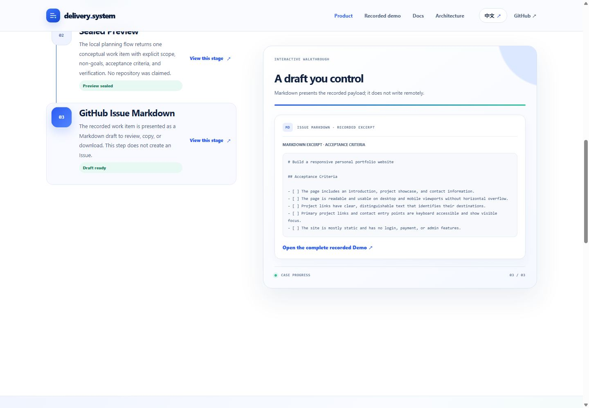 | 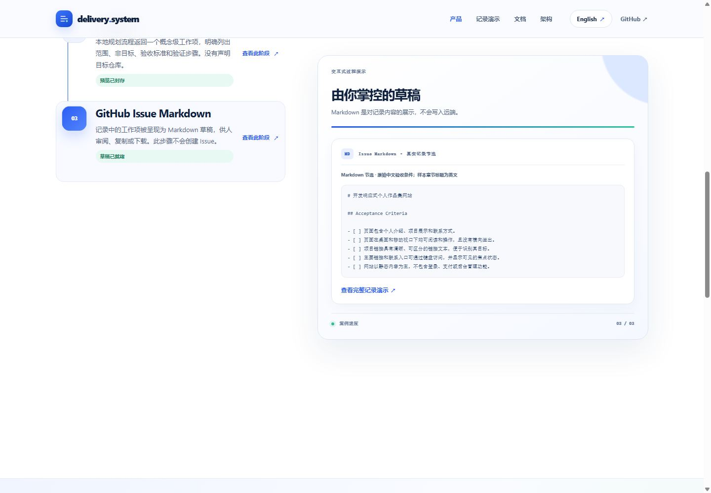 |
| Manual selection | 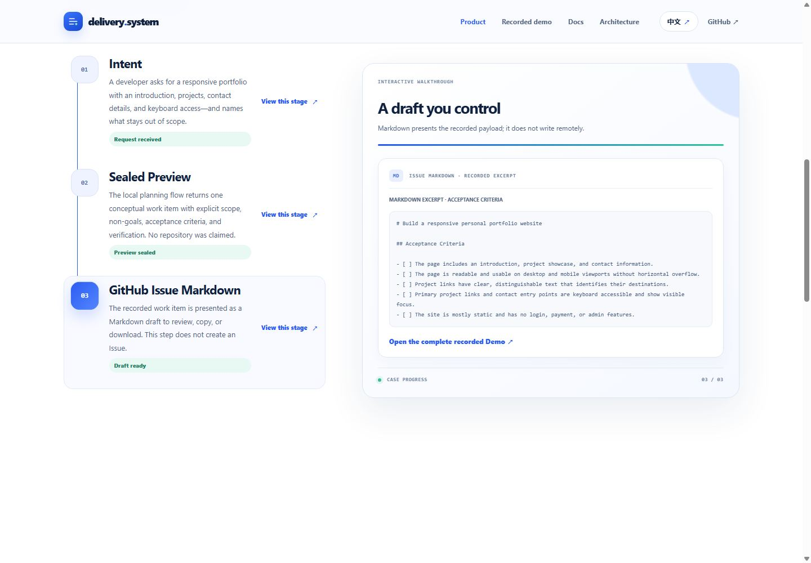 | 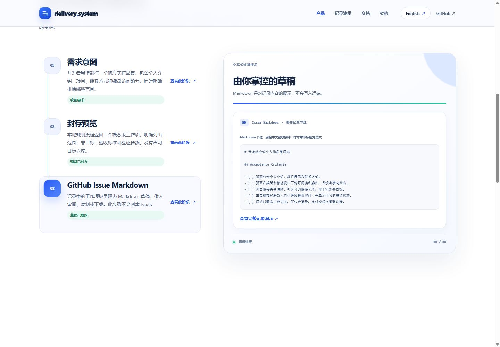 |

## Tablet

| Mode | English | Chinese |
| --- | --- | --- |
| Hybrid, automatic progression eligible | 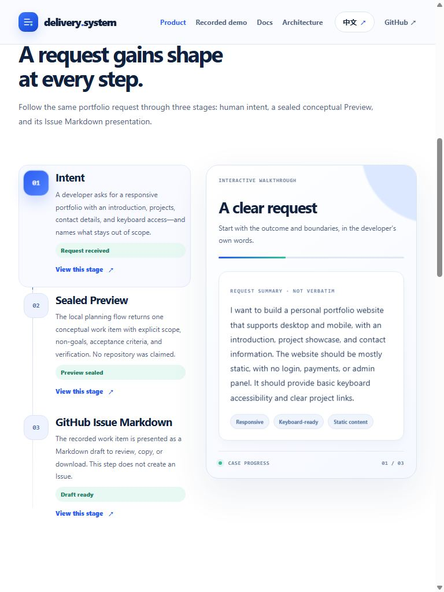 | 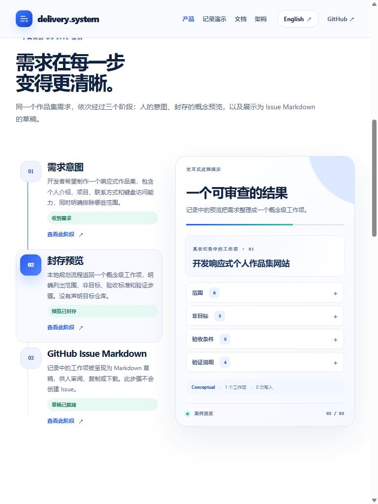 |
| Manual-first, constrained Panel | 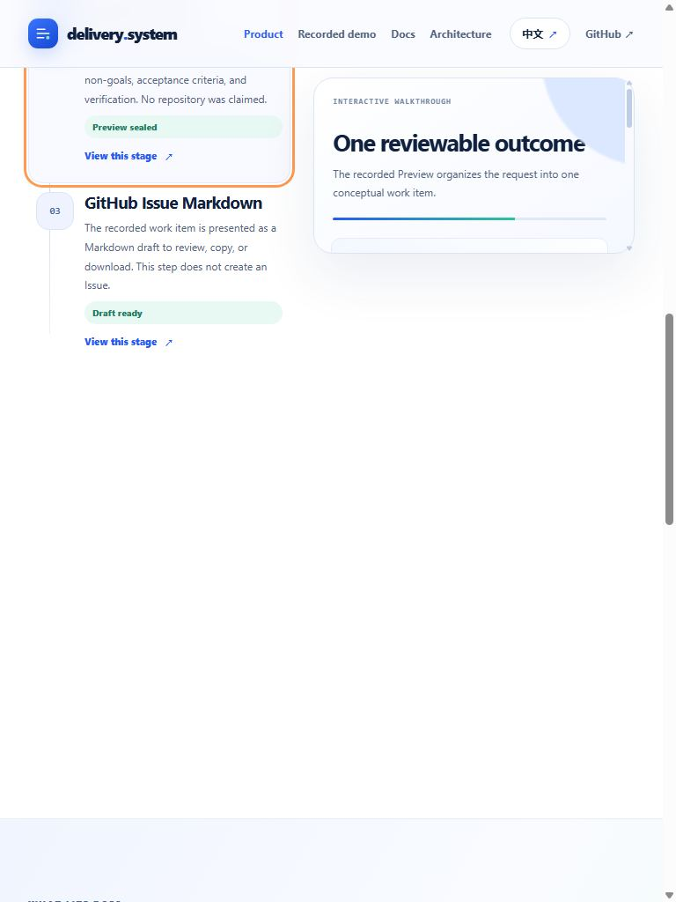 | 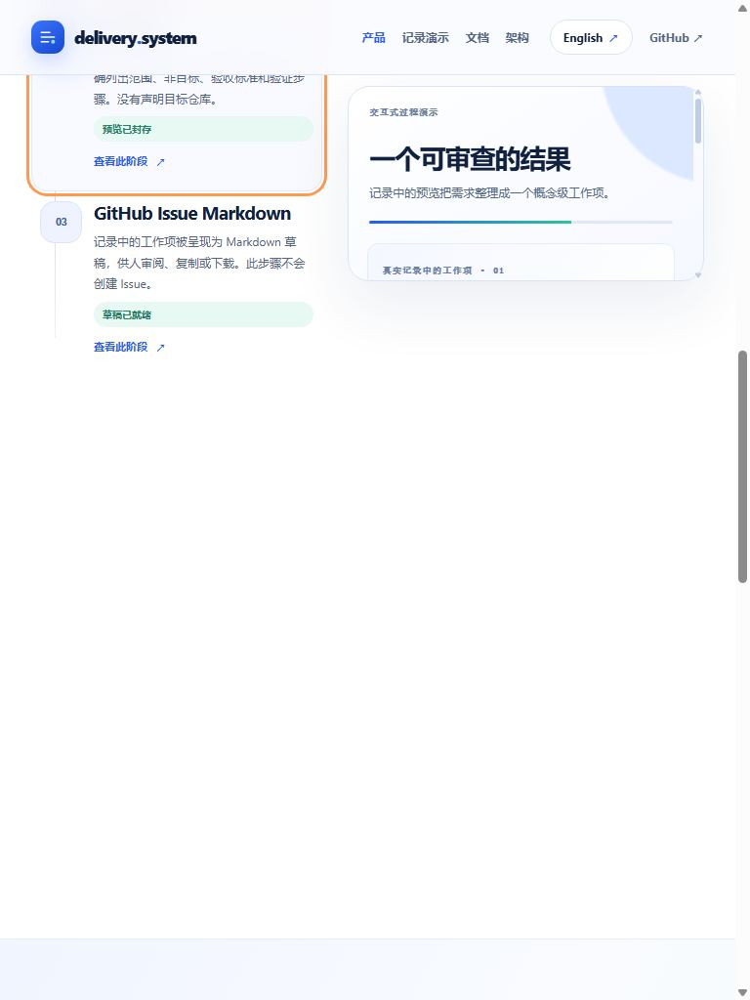 |

## Mobile

| Interaction | English | Chinese |
| --- | --- | --- |
| Natural touch scrolling | 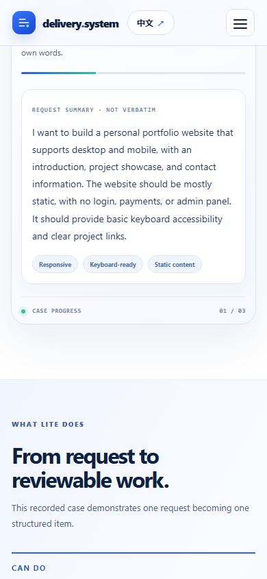 | 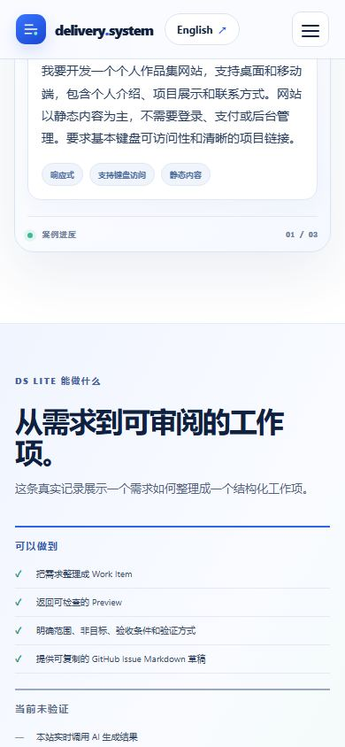 |
| Explicit manual selection | 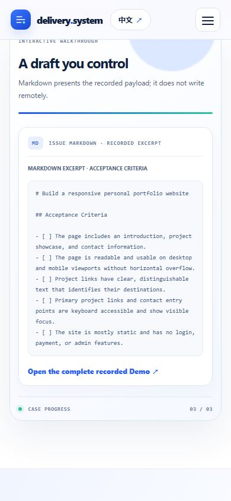 | 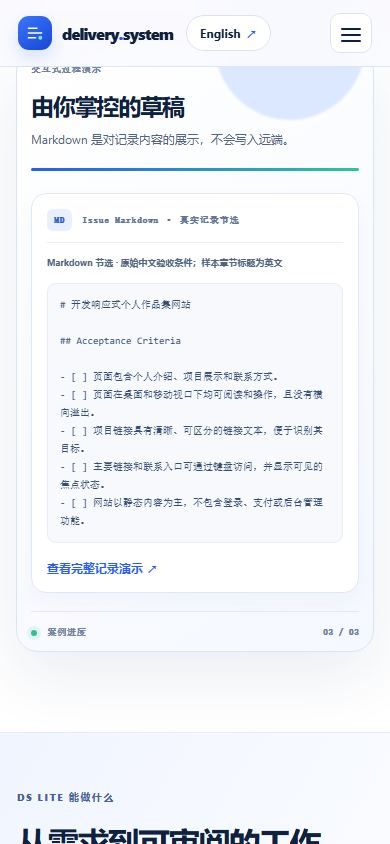 |
